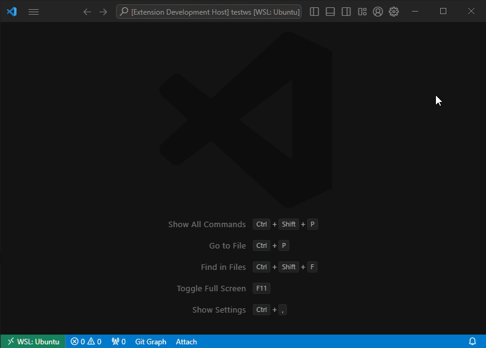

# eBUS Notebook

A VS Code extension providing a notebook for eBUS activities using [ebus-typespec](https://github.com/john30/ebus-typespec) and an optional [ebusd](https://github.com/john30/ebusd) or [micro-ebusd](https://github.com/john30/ebusd-esp32) connection, as well as some commands and code actions.

## Features

This extension provides a VS Code notebook that eases the process of creating/manipulating eBUS message definitions in TypeSpec using the [ebus-typespec](https://github.com/john30/ebus-typespec) library.

Such a notebook consists of several cells including typespec type cells that are used for defining the message(s).
Please refer to [`notebook.ebnb`](example/notebook.ebnb) for an example or run the `Create New eBUS Notebook` command.

Running a notebook cell only converts the TypeSpec to ebusd CSV and, if a host is configured and ebusd is used, reads the message from a real device. The cell status bar then offers uploading the conversion result to ebusd/micro-ebusd.

Furthermore it provides code actions in typespec files for converting and uploading individual models or the whole definition to an ebusd/micro-ebusd host, including a read of the message from a real device.

## Requirements

In order to use this extension, install
[TypeSpec for VS Code](https://marketplace.visualstudio.com/items?itemName=typespec.typespec-vscode)
in VS Code extensions as well as the
[eBUS TypeSpec package](https://github.com/john30/ebus-typespec) (at least version 0.3.1)
in the workspace:  
`npm i @ebusd/ebus-typespec`.

The best way to use this extension is by having an instance of ebusd or micro-ebusd running in the network that can test and decode the message definition(s), although this is optional.

When using an ebusd instance, it needs to have the "--enabledefine" switch set in order to use it for that.

The ebusd is accessed by this extension via the ebusd REPL (TCP)/micro-ebusd HTTP API. The host can be adjusted via the VS Code settings.

## Extension Settings

* `ebus-notebook.conversion.show`: Whether to show the conversion process in a terminal (`yes`), use a task instead of a terminal (`task`), or hide it (`no`, default).
* `ebus-notebook.conversion.cmd`: The command to use for converting TypeSpec to ebusd CSV (default is to call `tsp2ebusd` via npm exec). Wildcards `${inFile}` and `${outFile}` are replaced with the actual file names.
* `ebus-notebook.conversion.micro-ebusd-cmd`: The command to use for converting TypeSpec and uploading the result to micro-ebusd (default is to call `tsp2ebusd -m` via npm exec). Additional wildcards are `${target}` and `${inline}`.
* `ebus-notebook.ebusd.micro-ebusd-mode`: Whether the host is micro-ebusd instead of ebusd (`no`, default), and if so, whether to use inline mode (`yes` or `inline`).
* `ebus-notebook.ebusd.host`: The host name or IP address of ebusd/micro-ebusd to connect to, e.g. `localhost` (default unset). Use `https://<host-or-ip>` for SSL to micro-ebusd (if it is configured to use SSL).
* `ebus-notebook.ebusd.port`: The port number of the ebusd REPL to connect to (default `8888`). Ignored for micro-ebusd.
* `ebus-notebook.ebusd.read`: The command used for reading a generated definition from ebusd. Wildcards `${line}` (conversion result line) and `${input}` (user input) are replaced accordingly.
* `ebus-notebook.ebusd.micro-ebusd-read`: The command used for reading a previously uploaded definition from micro-ebusd. Wildcards `${circuit}`, `${name}` and `${input}` are replaced accordingly.

User input is asked for when the read command contains `${input}` and the toggle for querying input is enabled (in a notebook).

## Release Notes

Please refer to the [CHANGELOG](CHANGELOG.md) for release infos.
